## Lab 7 - The Advanced Encryption Standard (AES)

### Introduction

In this lab, a hardware accelerator was built in order to perfom 128-bit AES encryption. The STM32 sends a plaintext and key to the FPGA using SPI. The FPGA then cyhpers the text and sends it back to the MCU and confirms it was cyphered correctly. 

### Design and Testing Methodology

The AES encryption was implemented using 14 systemverilog modules and one C source file for the STM32 MCU. For the FPGA, the control and datapath logic are kept separate. The top module aes instantiates both of them. 

The source code for the project can be found in the associated
[Github repository](https://github.com/estgonzalez-hub/Micro_Ps)

### Block Diagrams 

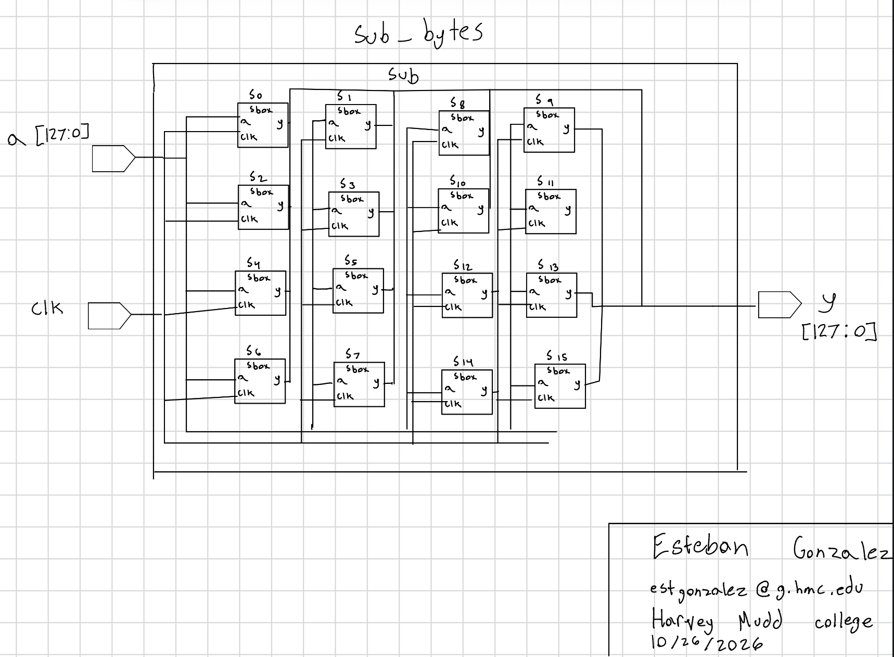{fig-cap="Figure 1. "}

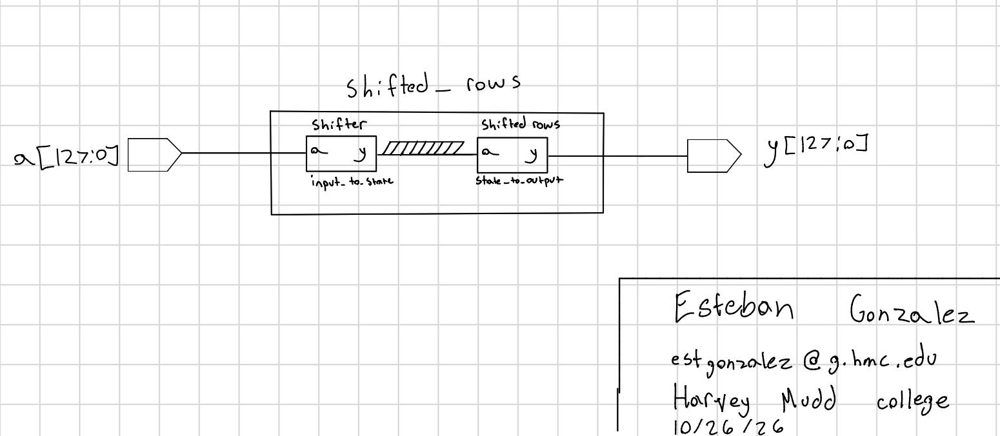{fig-cap="Figure 2. "}

.jpg){fig-cap="Figure 3. "}

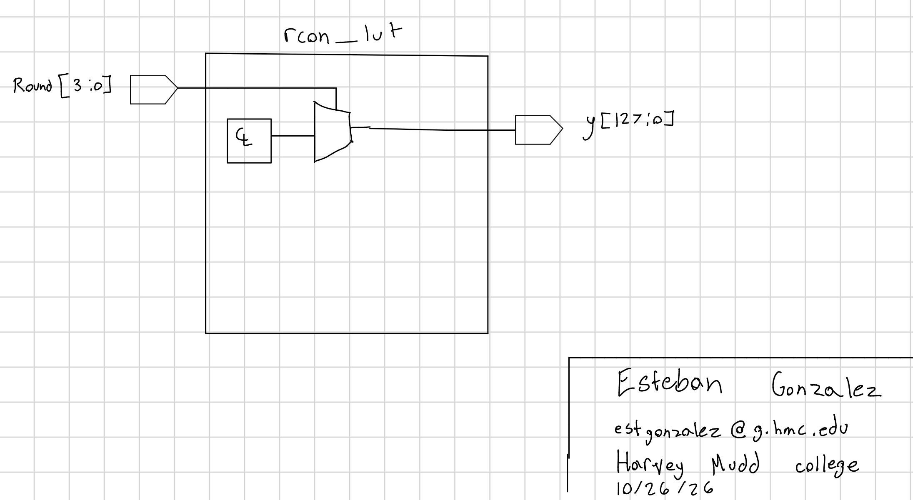{fig-cap="Figure 4. "}

.jpg){fig-cap="Figure 5. "}

.jpg){fig-cap="Figure 6. "}

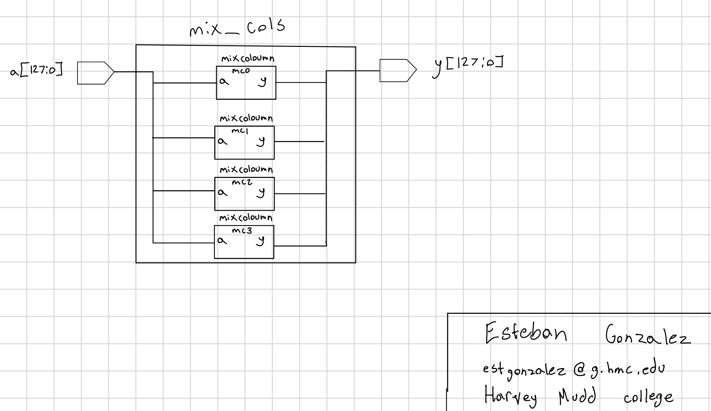{fig-cap="Figure 7. "}

.jpg){fig-cap="Figure 8. "}

### Testbench Simulation

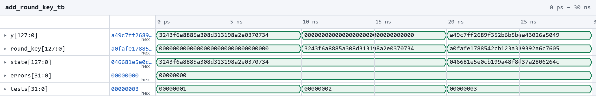{fig-cap="Figure 3. Waveform showing the module being tested"}

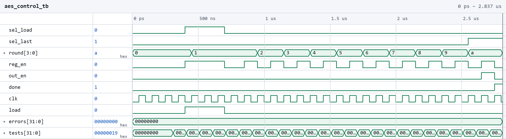{fig-cap="Figure 4. Waveform showing the module being tested."}

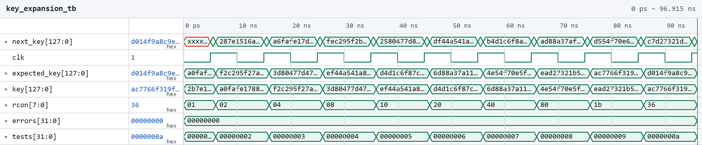{fig-cap="Figure 5. Waveform showing the  module being tested."}

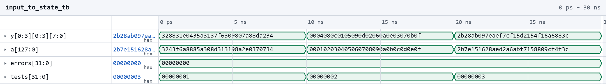{fig-cap="Figure 4. Waveform showing the  module being tested."}

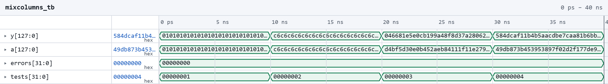{fig-cap="Figure 4. Waveform showing the  module being tested."}

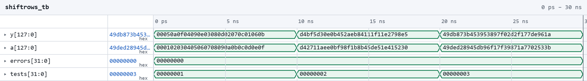{fig-cap="Figure 4. Waveform showing the  module being tested."}

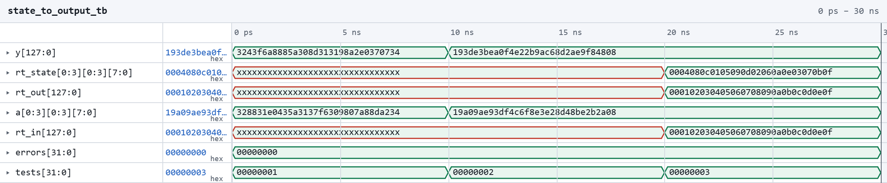{fig-cap="Figure 4. Waveform showing the  module being tested."}

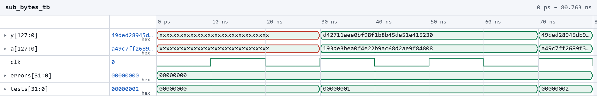{fig-cap="Figure 4. Waveform showing the  module being tested."}

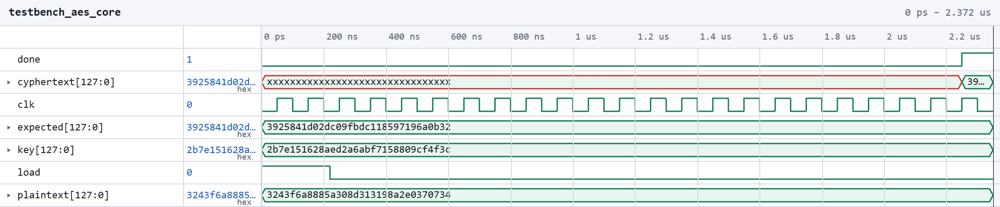{fig-cap="Figure 4. Waveform showing the  module being tested."}

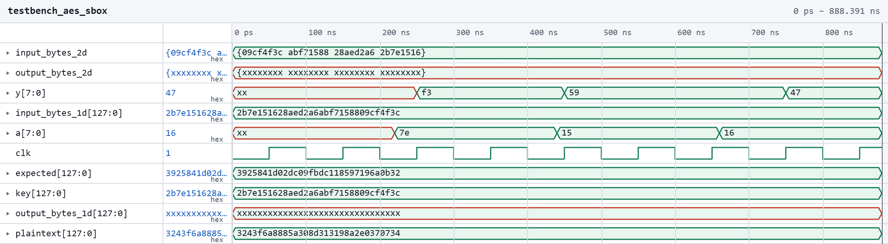{fig-cap="Figure 4. Waveform showing the  module being tested."}

### Logic Analyzer 

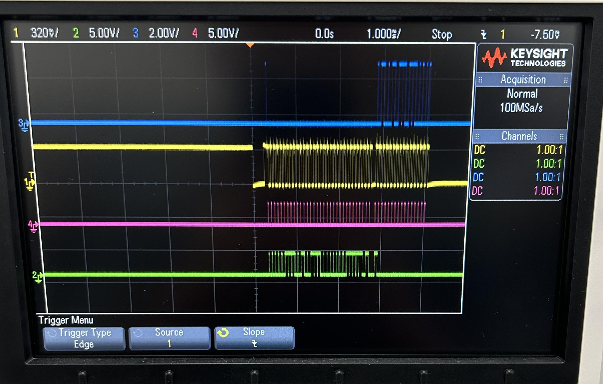{fig-cap=" Logic analyzer showing SPI connection between FPGA and MCU"}

### Conclusion

The lab worked as expected. I spent about 23 hours on this lab. 

### AI Prototype Summary

I used Gemini to complete the ai Prototype. When I uploaded the file i got this result, 
module KeyExpansion_AES128 (
    input  logic [127:0] prev_key,   // w[i-4], w[i-3], w[i-2], w[i-1]
    input  logic [3:0]   round_num,  // Current round number (1 to 10)
    output logic [127:0] next_key    // w[i], w[i+1], w[i+2], w[i+3]
);

    logic [31:0] w0, w1, w2, w3;
    logic [31:0] w0_next, w1_next, w2_next, w3_next;
    logic [31:0] rot_word_out, sub_word_out, temp;
    logic [31:0] rcon;

    // Split the previous 128-bit key into four 32-bit words
    assign w0 = prev_key[127:96];
    assign w1 = prev_key[95:64];
    assign w2 = prev_key[63:32];
    assign w3 = prev_key[31:0];

    // Instantiate RotWord module (cyclically permutes [a0,a1,a2,a3] to [a1,a2,a3,a0])
    RotWord rot_word_inst (
        .in_word(w3),
        .out_word(rot_word_out)
    );

    // Instantiate SubWord module (applies S-box to each of the four bytes)
    SubWord sub_word_inst (
        .in_word(rot_word_out),
        .out_word(sub_word_out)
    );

    // Round Constant (Rcon) multiplexer based on round number
    always_comb begin
        case (round_num)
            4'd1:  rcon = 32'h01000000;
            4'd2:  rcon = 32'h02000000;
            4'd3:  rcon = 32'h04000000;
            4'd4:  rcon = 32'h08000000;
            4'd5:  rcon = 32'h10000000;
            4'd6:  rcon = 32'h20000000;
            4'd7:  rcon = 32'h40000000;
            4'd8:  rcon = 32'h80000000;
            4'd9:  rcon = 32'h1b000000;
            4'd10: rcon = 32'h36000000;
            default: rcon = 32'h00000000;
        endcase
    end

    // Calculate temp for AES-128: SubWord(RotWord(w[i-1])) XOR Rcon[i/Nk]
    assign temp = sub_word_out ^ rcon;

    // Calculate the next four words sequentially
    assign w0_next = w0 ^ temp;          // w[i]   = w[i-Nk] XOR temp
    assign w1_next = w1 ^ w0_next;       // w[i+1] = w[i+1-Nk] XOR w[i]
    assign w2_next = w2 ^ w1_next;       // w[i+2] = w[i+2-Nk] XOR w[i+1]
    assign w3_next = w3 ^ w2_next;       // w[i+3] = w[i+3-Nk] XOR w[i+2]

    // Concatenate to form the next 128-bit round key
    assign next_key = {w0_next, w1_next, w2_next, w3_next};

endmodule

Then received this without the file upload, 
module key_expansion_unrolled #(
    parameter int Nk = 4,
    parameter int Nr = 10,
    parameter int WORD_WIDTH = 32
) (
    // Assuming key is an array of bytes to match key[4*i..4*i+3]
    input  logic [7:0]          key  [0 : 4*Nk-1], 
    input  logic [WORD_WIDTH-1:0] Rcon [0 : (4*Nr+3)/Nk],
    output logic [WORD_WIDTH-1:0] w    [0 : 4*Nr+3]
);

    genvar i;
    generate
        // First loop: i = 0 to Nk-1
        for (i = 0; i < Nk; i++) begin : gen_init_w
            // Pack 4 bytes of the key into one 32-bit word
            assign w[i] = {key[4*i], key[4*i+1], key[4*i+2], key[4*i+3]};
        end

        // Second loop: i = Nk to 4*Nr + 3
        for (i = Nk; i <= 4 * Nr + 3; i++) begin : gen_expand_w
            logic [WORD_WIDTH-1:0] temp;
            logic [WORD_WIDTH-1:0] temp_mod1;
            logic [WORD_WIDTH-1:0] temp_mod2;

            if (i % Nk == 0) begin : gen_mod_0
                // temp <- module1(module2(temp)) (+) Rcon[i/Nk]
                module2 m2 (
                    .in  (w[i-1]),
                    .out (temp_mod2)
                );
                module1 m1 (
                    .in  (temp_mod2),
                    .out (temp_mod1)
                );
                assign temp = temp_mod1 ^ Rcon[i/Nk];
                
            end else if (Nk > 6 && i % Nk == 4) begin : gen_mod_4
                // temp <- module1(temp)
                module1 m1 (
                    .in  (w[i-1]),
                    .out (temp_mod1)
                );
                assign temp = temp_mod1;
                
            end else begin : gen_mod_none
                // Direct pass-through
                assign temp = w[i-1];
            end

            // w[i] <- w[i-Nk] (+) temp
            assign w[i] = w[i-Nk] ^ temp;
        end
    endgenerate

endmodule

I was surprised that the AI did not infer or use background knowledge for the second attempt. Although it worked this time, I would still not trust the AI when telling it to not use background information. 
