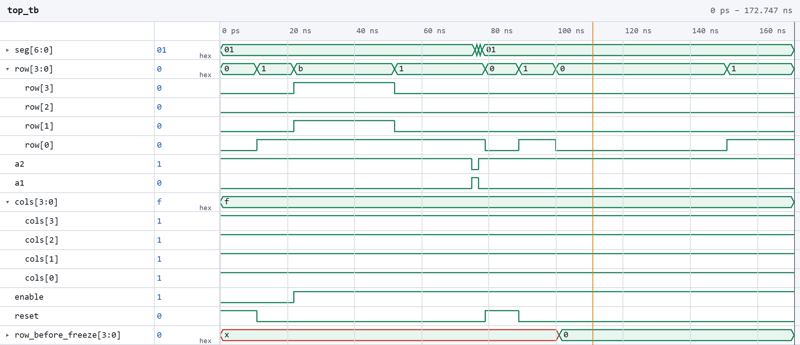
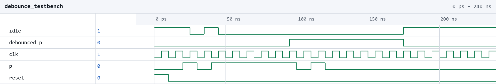
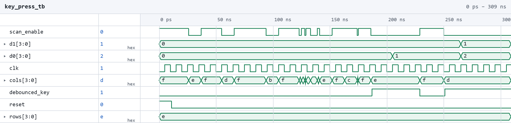
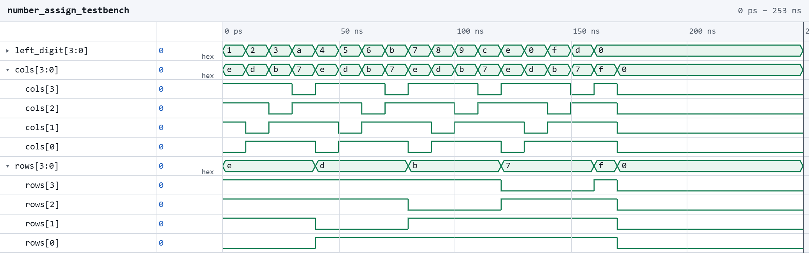

## Lab 7 - The Advanced Encryption Standard (AES)

### Introduction

In this lab, a hardware accelerator was built in order to perfom 128-bit AES encryption. The STM32 sends a plaintext and key to the FPGA using SPI. The FPGA then cyhpers the text and sends it back to the MCU and confirms it was cyphered correctly. 

### Design and Testing Methodology

The AES encryption was implemented using 14 systemverilog modules and one C source file for the STM32 MCU. For the FPGA, the control and datapath logic are kept separate. The top module aes instantiates both of them. 

The source code for the project can be found in the associated
[Github repository](https://github.com/estgonzalez-hub/Micro_Ps)

### Block Diagrams 

{fig-cap="Figure 1. "}

{fig-cap="Figure 2. "}

### Testbench Simulation

The design met all intended design objectives. A testbench was created to test each module as it was created. The waveforms for the modules are provided 

{fig-cap="Figure 3. Waveform showing the top module being tested"}

The screenshot above shows the QuestaSim simulation for the top module. 

{fig-cap="Figure 4. Waveform showing the debounce module being tested."}

The screenshot above shows the QuestaSim simulation for the debounce module. 

{fig-cap="Figure 5. Waveform showing the key press module being tested."}

The screenshot above shows the QuestaSim simulation for the keypress module. 

{fig-cap="Figure 4. Waveform showing the number assign module being tested."}

The screenshot above shows the QuestaSim simulation for the debounce module.

### Conclusion

### AI Prototype Summary

