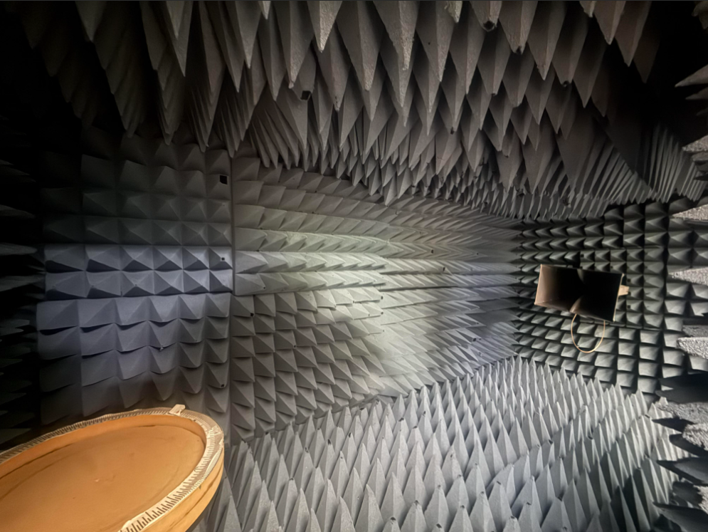
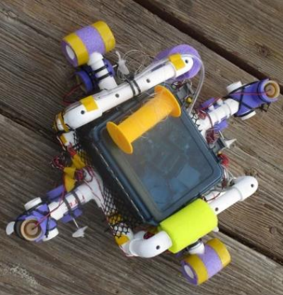
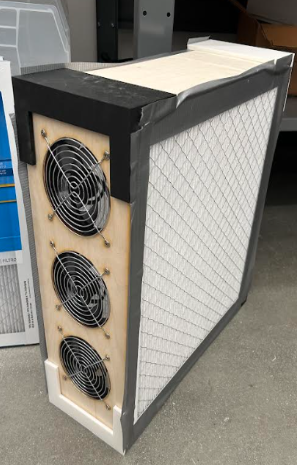

::: {#hero}
I am a Junior Engineering student at Harvey Mudd College passionate about electrical engineering and hardware design. My technical interests range from digital system design with microprocessors and FPGAs to Radio Frequency circuitry and signal processing.
:::

## Projects

:::::: {.card .shadow-sm .rounded-4 .border-0 .bg-light .p-3 .mb-3}

::::: {.grid .align-items-center}

::: {.g-col-12 .g-col-md-5}
{.img-fluid .rounded-3 fig-alt="CRPA Testing Setup"}
:::

::: {.g-col-12 .g-col-md-7}

::: {.text-uppercase .text-muted .fw-semibold .small .border-bottom .border-dark .pb-1 .mb-2}
Aug 2026 – Present · Harvey Mudd College
:::

::: {.fs-3 .fw-bold .text-uppercase .lh-1 .mb-2}
CRPA Antenna Characterization
:::

[SDRs]{.badge .rounded-pill .text-bg-info} [RF Testing]{.badge .rounded-pill .text-bg-info} [MATLAB]{.badge .rounded-pill .text-bg-info} [Signal Processing]{.badge .rounded-pill .text-bg-info}

Leading SDR signal processing to test and characterize a Controlled Reception Pattern Antenna (CRPA) array for anti-jamming performance and null steering.

[View Project →](crpa_charecterization.qmd){.btn .btn-info .btn-sm .rounded-pill}

:::

:::::

::::::

:::::: {.card .shadow-sm .rounded-4 .border-0 .bg-light .p-3 .mb-3}

::::: {.grid .align-items-center}

::: {.g-col-12 .g-col-md-5}
{.img-fluid .rounded-3 fig-alt="Autonomous Diving Robot"}
:::

::: {.g-col-12 .g-col-md-7}

::: {.text-uppercase .text-muted .fw-semibold .small .border-bottom .border-dark .pb-1 .mb-2}
Spring 2026 · Hardware Lead
:::

::: {.fs-3 .fw-bold .text-uppercase .lh-1 .mb-2}
Autonomous Underwater Robot
:::

[Robotics]{.badge .rounded-pill .text-bg-info} [Microcontrollers]{.badge .rounded-pill .text-bg-info} [Sonar]{.badge .rounded-pill .text-bg-info} [3D Mapping]{.badge .rounded-pill .text-bg-info}

Designed and fabricated an autonomous underwater vehicle with custom sonar and sensor fusion for high-resolution bathymetric floor mapping.

[View Project →](auv.qmd){.btn .btn-info .btn-sm .rounded-pill}

:::

:::::

::::::

:::::: {.card .shadow-sm .rounded-4 .border-0 .bg-light .p-3 .mb-3}

::::: {.grid .align-items-center}

::: {.g-col-12 .g-col-md-5}
{.img-fluid .rounded-3 fig-alt="Smart Air Purifier Prototype"}
:::

::: {.g-col-12 .g-col-md-7}

::: {.text-uppercase .text-muted .fw-semibold .small .border-bottom .border-dark .pb-1 .mb-2}
Summer 2026 · LILAQ Research
:::

::: {.fs-3 .fw-bold .text-uppercase .lh-1 .mb-2}
Smart High-CADR Air Purifier
:::

[Embedded Systems]{.badge .rounded-pill .text-bg-info} [Sensors]{.badge .rounded-pill .text-bg-info} [C/C++]{.badge .rounded-pill .text-bg-info} [Prototyping]{.badge .rounded-pill .text-bg-info}

Engineered a custom DIY air purification system that outperforms commercial units in Clean Air Delivery Rate (CADR) at a fraction of the cost.

[View Project →](air_purifier.qmd){.btn .btn-info .btn-sm .rounded-pill}

:::

:::::

::::::